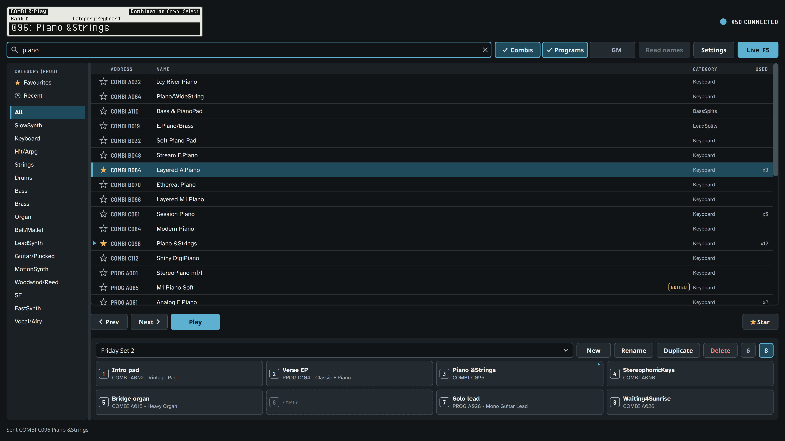
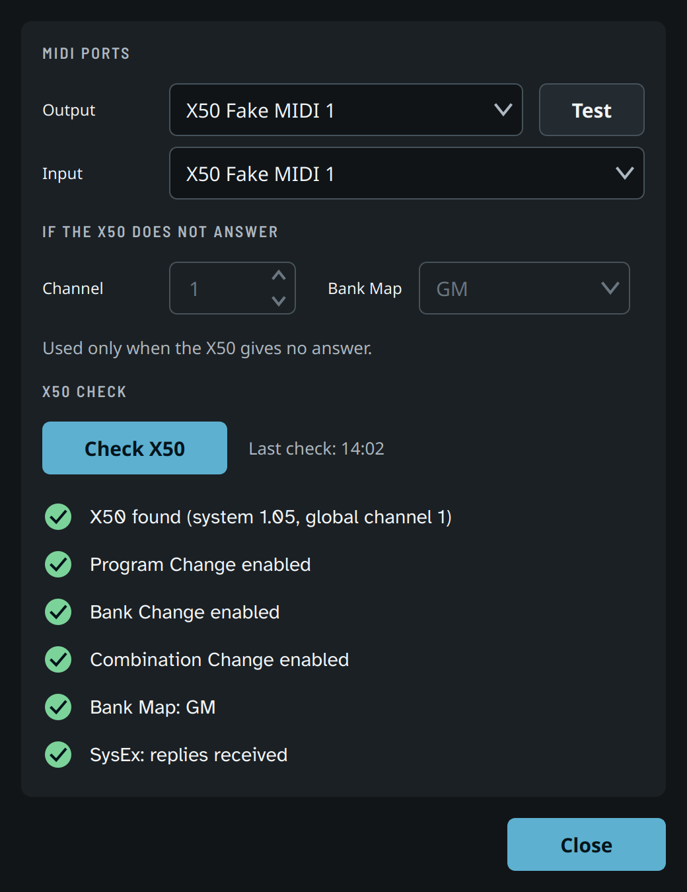
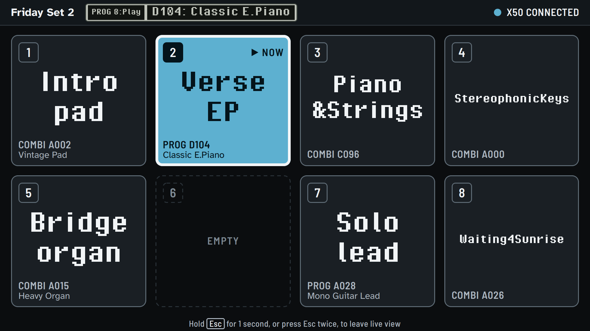
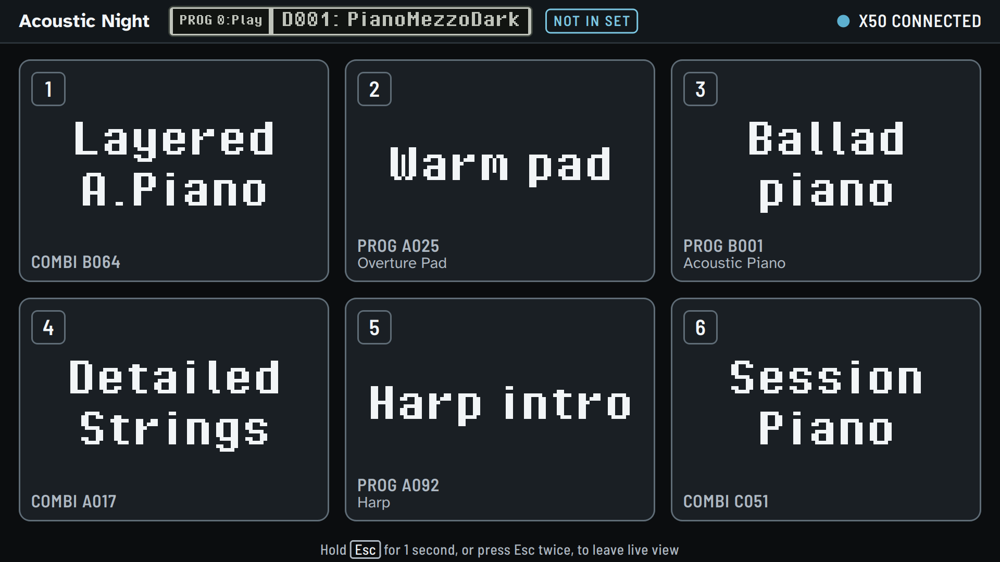

# X50 Patch Switcher

X50 Patch Switcher finds and selects programs and combinations on a KORG X50 from a
laptop, over USB. It is for a keyboard player with a KORG X50 who needs to find sounds
quickly at rehearsal and switch them on stage: browse and search the factory sounds,
arrange the sounds of each set, then play the set from a full-screen live page of 6 or
8 large buttons. It never writes to the X50's memory and works fully offline.

KORG and X50 are trademarks of KORG Inc. This project is not affiliated with KORG.

**Status: beta (0.9.0).**

## Screenshots

| Browse and search | Settings |
|---|---|
|  |  |

| Live view, 8 sounds | Live view, 6 sounds |
|---|---|
|  |  |

The screenshots are rendered by the app itself, headless, with the simulated X50
(`--fake-midi`).

## Download

- **Windows:** portable zip (about 12.5 MB). Unzip it anywhere; no installer and no
  administrator rights.
- **Linux:** AppImage (about 30 MB), x86_64.
- **macOS:** universal dmg (about 23 MB), macOS 12 or later.

The builds are produced by GitHub Actions. Download them from the
[Actions page](https://github.com/MarcAstr0/x50-patch-switcher/actions) (open the latest
green run and take the file from its artifacts). From v1.0.0 the builds will also be on
the [Releases page](https://github.com/MarcAstr0/x50-patch-switcher/releases).

## First run

### Windows

1. Unzip the whole folder: right-click the zip, "Extract all". Do not run anything from
   inside the zip.
2. Plug the X50 in by USB and turn it on.
3. Windows SmartScreen may warn that the app is unknown, because the exe is not code
   signed. Click **More info**, then **Run anyway**. This is needed once.
4. **Port busy:** if the status says "port busy (another program is using the X50)",
   close KORG's editor or any DAW that has the X50 open, then reconnect or restart the
   app.
5. **Portable mode (optional):** to keep the settings and sets on a USB stick, create an
   empty file named `portable` (no extension) next to the exe. The app then saves
   everything in its own folder instead of your user profile.

### macOS

The dmg is ad-hoc signed and not notarised. The first time, right-click the app and
choose **Open**, then confirm.

### Linux

Make the AppImage executable (`chmod +x`) and run it. Your user needs access to the ALSA
sequencer (normally the case on desktop distributions).

## Using it

**Browse** (at home or in rehearsal):

- Type in the search box at the top. Several words are matched together. An address
  such as `A012`, `PROG A012` or `G1` finds a sound by number, and `cat:` followed by a
  category name filters by category.
- The kind toggles (Combis, Programs, GM) show or hide each kind of sound.
- The category list on the left has **Favourites** and **Recent** at the top, then
  the categories and **All**.
- Highlighting a sound never sends it. **Enter**, a double-click or the **Play** button
  sends it to the X50.
- **Ctrl+Left / Ctrl+Right** (or **PgUp / PgDn** when the list does not have focus) step
  through the results and send each one. Stepping does not wrap around.
- **Ctrl+D** or a click on the star makes a sound a favourite.
- **Sets:** a set is an ordered list of 6 or 8 sounds, one set per setlist. Create,
  rename, duplicate or delete sets from the set editor. Put the highlighted sound into
  slot 1 to 8 with **Ctrl+1** to **Ctrl+8**, or drag sounds between slots. Double-click a
  slot to give it a label, such as a song name.

**Live** (on stage):

- Press **F5** or the Live button to go full screen. Tap or click a button to switch the
  X50 to that sound.
- Keys **1** to **8** send that slot.
- **Right**, **Down**, **Space** or **PgDn** move to the next slot; **Left**, **Up** or
  **PgUp** move to the previous one. Each press moves one slot, empty slots are skipped
  and the list does not wrap. Page-turner foot pedals that send these keys work.
- Pressing the slot that is already lit sends it again.
- **Ctrl+Left / Ctrl+Right** (or `[` and `]`, which need AltGr on some keyboards) switch
  to the previous or next set.
- To leave live view, hold **Esc** for one second, or press **Esc** twice within one
  second. Alt+F4 does not close the app while live view is open; leave with Esc first.
- The top bar shows the set name, the connection state (X50 CONNECTED or NO X50) and
  the mode the X50 is in (PROG or COMBI). Errors appear only in the top bar.
- While live view is open, the display does not go to sleep on Windows.

**Footprint:** the app is small. On the Linux test build the process used about 45 MB
of memory in browse view and about 43 MB in live view, and idle CPU use was 0.1 % or less.
The SPEC limit is 60 MB on Windows.

**Keyboard player's one-page guide (Spanish):** [docs/GUIDE.md](docs/GUIDE.md).

## Command line

Run the exe (Windows) or the binary (`./build/x50-patch-switcher`) with these options.

| Flag | Does |
|---|---|
| `--list-ports` | print output and input port names, exit 0 |
| `--port <substr>`, `--in-port <substr>` | override the saved ports |
| `--channel <1-16>` | override the global channel |
| `--send <address>` | send one sound and exit (0 ok, 2 bad address, 3 no port) |
| `--probe` | run the probe, print the checklist, exit 0 if all ✓ else 1 |
| `--diagnose <dir>` | probe, then read every bank, write `report.txt` and raw `.syx` captures to `<dir>`, exit |
| `--fake-midi` | use the simulated X50 (tests, screenshots, demos) |
| `--config-dir <dir>` | use another config directory |
| `--screenshot <png> [--screenshot-state <name>]` | render a view headless and exit |
| `--screenshot-scale <n>` | device pixel scale of the screenshot (the screenshots here use 2) (1, 1.25, 1.5 or 2) |

Screenshot states: `browse`, `browse-search`, `settings`, `settings-errors`, `live-8`,
`live-6`, `live-disconnected`.

Exit codes:

| Code | Meaning |
|---|---|
| 0 | ok |
| 1 | probe check failed, diagnose incomplete, or port enumeration failed |
| 2 | bad or ambiguous address, or bad option |
| 3 | no matching port |
| 4 | send failed (busy, NAK or lost), or diagnose could not write its files |
| 5 | a microX answered (the microX is not supported) |
| 6 | screenshot could not be written |

`--diagnose` is for reporting problems. The Windows zip includes `Diagnose X50.bat`,
which runs it into a folder on the Desktop and opens that folder.

## Building from source

Requirements: CMake 3.24 or newer, Qt 6 (6.4 or newer) with Widgets, and a C++17
compiler. RtMidi 6.0.0 is fetched by CMake on the first build. CI builds with GCC on Ubuntu 24.04,
MSVC 2022 or newer on Windows and AppleClang on macOS 15.

```sh
cmake -S . -B build -DCMAKE_BUILD_TYPE=Release     # first time fetches RtMidi 6.0.0
cmake --build build -j
ctest --test-dir build --output-on-failure          # headless; tests set QT_QPA_PLATFORM=offscreen
./build/x50-patch-switcher --list-ports
./build/x50-patch-switcher --fake-midi              # the GUI against the simulated X50
./build/x50-patch-switcher --probe --fake-midi
```

Platforms: Windows 10/11 x64 (MSVC 2022, built by CI), Linux x86_64 (ALSA), macOS 12+
(CoreMIDI).

## Licence

MIT. See [LICENSE](LICENSE).

The fonts are licensed separately: Atkinson Hyperlegible and Barlow Semi Condensed under
the SIL Open Font License 1.1; Pixel Operator (modified and renamed Pixel Operator X50)
under CC0 1.0. See [assets/README.md](assets/README.md).
